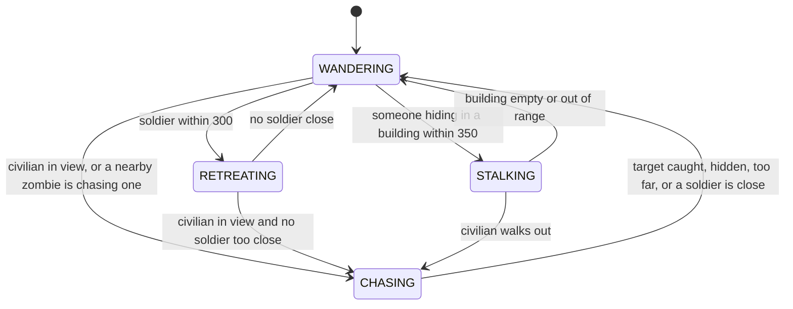

# COMP2000 Worksheet 2 — Final Submission

**Student name:** Nicholas Fang

**GitHub repo URL:** https://github.com/nickf213/Git-Wreckers-on-a-Zombie-mission

---

## 1. Design Patterns

A diagram of the pattern (as a Mermaid state diagram, to render and export as the PDF) is at the end of this section.

**1.1. Which design pattern(s) did you implement? Name them and state where each appears in your codebase.**

I implemented the **State pattern** in `Zombie.java`. The zombie has four states, WANDERING, CHASING, STALKING and RETREATING, held as the constants of a private nested enum `Zombie.Mode`. `Zombie.update()` delegates its behaviour to whichever mode is current, and the method `decideMode(World)` is the single place where the mode changes.

The codebase also has a **Strategy pattern** (`MovementBehaviour` with `PatrolBehaviour` and `HuntBehaviour`, used by `Military`). That is a teammate's work, not mine, but I considered it as an alternative for the zombie (see 1.3).

**1.2. For each pattern, paste a code snippet showing the key interaction between participants.**

The context (`Zombie`) picks a mode each tick and runs that mode's behaviour:

```java
@Override
public void update(World world) {
    mode = decideMode(world);
    mode.behaviour.accept(this, world);
}
```

The transition rules, all in one method, in priority order:

```java
private Mode decideMode(World world) {
    if (mode == Mode.CHASING && target != null
            && worthChasing(target, world)) {
        return Mode.CHASING;
    }

    target = null;

    Optional<Human> prey = preyInView(world)
            .filter(human -> !soldierTooClose(human, world));

    if (prey.isPresent()) {
        target = prey.get();
        return Mode.CHASING;
    }

    if (nearestSoldier(world).isPresent()) {
        return Mode.RETREATING;
    }

    if (occupiedBuildingNearby(world).isPresent()) {
        return Mode.STALKING;
    }

    return Mode.WANDERING;
}
```

The states themselves, each holding its behaviour as a lambda:

```java
private enum Mode {
    WANDERING((zombie, world) -> zombie.wander(world)),
    CHASING((zombie, world) -> zombie.chaseAndInfect(world)),
    STALKING((zombie, world) -> zombie.occupiedBuildingNearby(world)
            .ifPresent(building -> zombie.stalk(building, world))),
    RETREATING((zombie, world) -> zombie.nearestSoldier(world)
            .ifPresent(soldier -> zombie.retreat(soldier, world)));

    private final BiConsumer<Zombie, World> behaviour;

    Mode(BiConsumer<Zombie, World> behaviour) {
        this.behaviour = behaviour;
    }
}
```

**1.3. For each pattern, explain why you chose it over an alternative. What trade-off did you make?**

The zombie's behaviour changes at runtime depending on what it senses (a human in view, a soldier nearby, people hiding in a building), so I wanted each behaviour separate and easy to change.

- *If/else on a flag (the original code):* it worked for two modes but gets tangled as soon as more are added, because every new mode touches the same method.
- *An enum with a switch:* better, but still one big method that grows with every state.
- *Strategy, as `Military` uses it:* a strategy swaps an algorithm, but it does not model "which mode the zombie is currently in", and something outside it still has to decide when to switch. State fits better.
- *Separate State classes:* I built these first (`ZombieState`, `WanderingState`, `ChasingState`), then replaced them with lambdas in an enum. Each mode is only a few lines, so separate classes were mostly boilerplate, and the lambdas stand in for what would otherwise be a class hierarchy.

Trade-offs: `Zombie.java` is longer because everything lives in one class. I also put all transitions in `decideMode` instead of letting each state pick its successor, as the textbook pattern does. With four states the rules interact, so having the priority order in one place made it easier to read and change, but it is a departure from the classic design. If the zombie gained many more states I would move them into separate classes.

**State diagram (Mermaid, for the PDF).** `decideMode` runs every tick, so any state can move to any other when the conditions change; the arrows show the main triggers.



---

## 2. Streams / Lambdas / Parallelism

**2.1. List every file in your project that uses lambda expressions or the Streams API.**

| File | Uses | Written by |
|---|---|---|
| `Zombie.java` | Streams: `visibleCivilians`, `findTarget`, `occupiedBuildingNearby`, `nearestSoldier`, `alertedTarget`, `spreadInfection`; collectors: `groupingBy`, `summarizingDouble`, custom `Collector.of`; parallel stream in `totalPreyScore`; lambdas in the `Mode` enum | me |
| `test/ZombieStreamTest.java` | Streams to collect and count entities in the tests | me |
| `Human.java` | Streams in `findNearestEntity` and `findNearestAvailableBuilding`, with `Comparator.comparingDouble` and `orElseThrow` | a teammate |
| `Military.java` | A stream in `findNearestZombie` | a teammate |
| `World.java` | A lambda in `removeIf(entity -> !entity.isActive())` | a teammate |
| `Main.java` | Lambdas for the Swing start-up, reset action and timer listeners | a teammate |
| `SimPanel.java` | A lambda for the no-op reset action in the constructor | a teammate |

**2.2. For the most sophisticated use, paste the code and explain: what does it do, and why was a stream/lambda better than a loop?**

The most sophisticated piece is the shared `visibleCivilians` stream together with the custom collector `preyScore`, and the parallel `totalPreyScore` built on top of it:

```java
Stream<Human> visibleCivilians(World world) {
    return world.getNearby(this, DETECTION_RADIUS).stream()
            .filter(entity -> entity instanceof Human
                    && !(entity instanceof Military))
            .map(entity -> (Human) entity)
            .filter(human -> !human.isHidden());
}

double preyScore(World world) {
    return visibleCivilians(world).collect(Collector.of(
            () -> new double[1],
            (total, human) -> total[0] +=
                    1.0 - distanceTo(human) / DETECTION_RADIUS,
            (left, right) -> {
                left[0] += right[0];
                return left;
            },
            total -> total[0]));
}

static double totalPreyScore(World world) {
    return world.getEntities().parallelStream()
            .filter(entity -> entity instanceof Zombie)
            .map(entity -> (Zombie) entity)
            .mapToDouble(zombie -> zombie.preyScore(world))
            .sum();
}
```

What it does: `visibleCivilians` defines who a zombie can see (active, not a soldier, not hiding) and returns a lazy stream. Different callers finish it differently: `findTarget` uses `min` to choose the closest, `countVisibleCivilians` uses `count`, `civiliansByDistanceBand` uses `groupingBy`, `visibleCivilianEnergy` uses `summarizingDouble`, and `preyScore` uses a custom collector that adds up how close each civilian is. `totalPreyScore` then sums that score across every zombie.

Why this beat a loop: with loops, each of those answers needs its own loop that repeats the same three filters, and a change to the "who is visible" rule has to be made in every copy. With the stream the rule lives in one place. It also made the code composable, and the parallel version is a one-word change from `stream()` to `parallelStream()`.

**2.3. Did you use parallel streams, custom collectors, or the Fork/Join framework? If yes, how did you ensure thread safety? If no, where could parallelism be introduced?**

- *Parallel stream:* yes, in `Zombie.totalPreyScore`.
- *Custom collector:* yes, `preyScore` uses `Collector.of` with a supplier, accumulator, combiner and finisher.
- *Fork/Join:* not used directly (parallel streams use it underneath).

Thread safety: each parallel task only reads the world and its own zombie, and nothing is written. The lambdas hold no shared mutable state (the custom collector's accumulator is a fresh `double[1]` per task, and the combiner merges them). The partial results are combined by `DoubleStream.sum()`. `World` itself is not thread-safe, so the method must only be called between ticks, never during `world.update()`. I checked it against a sequential sum on 40 zombies and 30 humans and again in a unit test with 20 and 15, and the totals matched.

Two honest limits. At this size the parallel version is probably not faster, because the overhead is larger than the work, so I use it to demonstrate the technique, not as an optimisation. And `preyScore` itself runs on a sequential stream, so its combiner is correct but is not exercised by a parallel pipeline.

Where parallelism could go next: a two-phase update. Let every zombie compute its next mode in parallel (this is read-only), then apply the moves sequentially so the world is only changed by one thread.

---

## 3. Uniqueness and Creativity

**3.1. What did you add to your simulation that went beyond the in-class activities? Describe the feature and what inspired it.**

All of this is in the `Zombie` class and was inspired by reading what the rest of the team's classes do:

- **A four-state zombie** built with the State pattern and lambdas (above).
- **Infection that spreads:** originally `Human.infect()` just removed the human, so the zombie population could only fall. Now an infected human rises as a new zombie where they fell, capped at 12 zombies (counted with a stream). I added it because in my 3000-tick test runs the single zombie was shot and nothing replaced it.
- **Crowd frenzy:** a speed boost of up to 1.5x when several civilians are in view, plus a 0.25 lunge when one is close. It turns the metrics collectors into behaviour.
- **Siege:** zombies gather at the entrance of the building with the most people hiding inside, using `Building`'s occupant count and entrance position. People who have to leave when they get hungry walk out into them.
- **Soldier avoidance:** zombies back away from `Military` units and break off a chase if a soldier gets close, because soldiers kill zombies within a tick or two.
- **Horde alert:** a zombie that sees nobody itself joins a nearby zombie's chase.
- **Ecosystem collectors:** `groupingBy` for distance bands, `summarizingDouble` for energy, and a custom collector for a prey score.

**3.2. Paste a code snippet or describe a design decision that demonstrates emergent behaviour, non-trivial complexity, or a genuinely surprising outcome.**

The horde alert is the clearest emergent behaviour, because no single zombie has it:

```java
Optional<Human> alertedTarget(World world) {
    return world.getNearby(this, ALERT_RADIUS).stream()
            .filter(entity -> entity instanceof Zombie)
            .map(entity -> (Zombie) entity)
            .filter(zombie -> zombie.mode == Mode.CHASING)
            .map(zombie -> zombie.target)
            .filter(human -> human != null
                    && human.isActive()
                    && !human.isHidden()
                    && distanceTo(human) <= PURSUIT_LIMIT)
            .min(Comparator.comparingDouble(this::distanceTo));
}
```

A zombie 316 units from a human, beyond its own 300-unit sight range, still joins a neighbour's chase and closed in to 243 units in a test. Combined with the siege and the frenzy boost, groups behave differently from lone zombies.

The surprising outcome was about balance, not code. In the default game there is one starting zombie, and it dies at about tick 45 because its first target is next to a soldier (0 of 8 test runs showed any spread). With two extra starting zombies the spread happened in 8 of 8 runs. Humans (speed 2.0) outran the original zombie speed (1.4), so the infection idea did nothing until I measured it and changed the speed, the starting count and the soldier avoidance together. Eight runs per setting is a small sample, so I treat small differences between versions as noise.

**3.3. If you had another 6 weeks, what would you add or change?**

- Make retreating zombies slide along walls so they do not get cornered, so a lone zombie can survive in the default game.
- A two-phase parallel update (decide in parallel, apply sequentially) to make the parallelism genuinely useful.
- Show the ecosystem metrics (distance bands, energy, prey score) on the screen, which needs a change to the team's `SimPanel`.
- Zombies that slowly decay unless they infect someone, so the population has real ups and downs.
- Take the starting zombie count from Khoi's `SimulationSettings` branch (still unmerged), and add `ZombieStreamTest` to the CI workflow, which only runs `HumanFoodTest` today.
- If the zombie gains more states, move them into separate State classes.

---

## 4. Log Book and Final Reflection

**4.1. Attach or link your log book entries for Weeks 7–13.**

*[To complete yourself.]*

**4.2. Reflect on the semester:**

- What was the most important concept you learned?

  *[To complete yourself.]*

- What design trade-off did you face, and how did you resolve it?

  *[To complete yourself.]*

- If you started over, what would you do differently?

  *[To complete yourself.]*

- What feedback from the Week 7 submission did you act on?

  *[To complete yourself.]*

---

## AI Use Statement

*[Edit this so it matches what you actually did and your unit's policy.]*

I used Claude (Anthropic) through Claude Code to help write and refactor `Zombie.java` and `ZombieStreamTest.java`, to review teammates' code, and to draft the text of this worksheet. I directed the work, ran and checked the results, and I am responsible for what is submitted.
